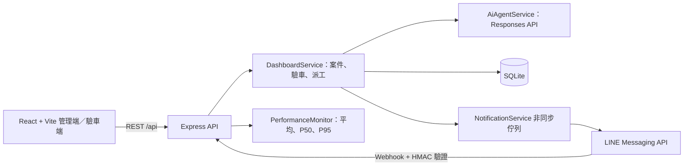

# iRent 專案架構

## 目錄

- `frontend/src/pages`：角色、管理端儀表板、LINE 通知、AI Agent 與系統設定頁面。
- `frontend/src/context/AppContext.tsx`：共用 API state 與三秒輪詢。
- `backend/src/controllers`：HTTP 輸入驗證與回應。
- `backend/src/services`：案件流程、OpenAI Agent、LINE 發送佇列與效能量測。
- `backend/src/repositories`：SQLite schema 與資料存取。
- `backend/src/routes`：一般 REST API；LINE Webhook 在 `app.ts` 以 raw body 優先註冊。
- `outputs`：SQLite、上傳圖片與舊版展示檔；不屬於新的前後端程式碼。

## 通知設計

- 新的通知寫入 `NotificationLog`，再由最多兩個背景工作者呼叫 LINE；案件 API 不等待外部 LINE 回應。
- LINE 每次最多嘗試兩次，每次呼叫最多四秒；結果和錯誤會寫入通知紀錄與案件 Timeline。
- Channel access token 只讀自環境變數，絕不儲存在 SQLite 或由管理頁回傳。

## 效能觀測

- `GET /api/performance` 回傳最近 200 個 API request 的平均、P50、P95 與錯誤率。
- AI Agent 只透過後端呼叫 Responses API，瀏覽器不會取得 API Key；回覆資料不落地保存。
- 目前 state 輪詢間隔為三秒。資料量顯著增加時，應改成摘要 API、分頁與 Server-Sent Events／WebSocket。
