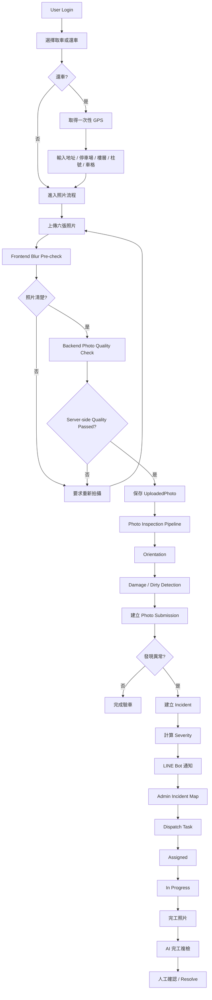

# iRent AI 驗車與營運派工系統

iRent AI 是一個 Hackathon 展示專案，將租車人的取車／還車照片轉換成可追蹤的營運案件。

系統從使用者上傳照片開始，先執行照片品質檢查，再進入車況分析流程。若發現車損或髒污，可建立 Incident、進行事件分級、LINE Bot 通知與後續派工；還車流程同時保存 GPS 與停車詳細位置，讓營運人員可以透過 OpenStreetMap 快速定位車輛。

整體目標是建立：

```text
Photo Inspection
→ Vehicle Condition Detection
→ Incident
→ Severity
→ LINE Notification
→ Dispatch
→ Resolution
```

的完整 AI-assisted fleet operations workflow。

---

# 核心功能

## Authentication 與權限

系統採用單一登入入口，並區分兩種角色：

- `user`：一般租車使用者
- `admin`：營運管理人員

實際權限由 Backend 與 SQLite `User` 資料決定，Frontend 的角色選擇只負責登入流程分流，不能用來取得額外權限。

安全機制包含：

- 密碼使用 Argon2id
- 瀏覽器只保存 HttpOnly opaque session cookie
- 資料庫只保存 session token 的 SHA-256 hash
- 所有寫入 API 使用 CSRF token
- Admin API 由 Backend RBAC 強制驗證
- User 只能存取自己的照片、Submission 與相關 Incident
- Admin 可存取完整 Dashboard、Incident、Dispatch 與營運功能

登入後：

```text
USER
→ /customer
→ 取車 / 還車驗車流程

ADMIN
→ /operator/dashboard
→ 營運 Dashboard
```

Admin 不提供一般使用者照片上傳入口。

---

# 租車人端

一般使用者可以：

- 選擇取車或還車驗車流程
- 輸入租約編號與車牌
- 上傳六個指定角度照片
- 即時查看照片品質檢查結果
- 模糊照片不允許提交
- 重新拍攝或重新選擇照片
- 六張照片皆通過後送出驗車資料
- 查看本次 AI 驗車摘要
- 完成送出後顯示成功結果與 Submission ID

目前照片品質檢查採 Hybrid 架構：

```text
Select Image
      ↓
Frontend lightweight blur pre-check
      ↓
   Failed
      ↓
要求重新拍攝
不傳送原始圖片

      ↓ Passed

Backend Photo Quality API
      ↓
Server-side Laplacian validation
      ↓
Passed / Failed
```

Frontend 的檢查只用於提升 UX。

Backend 才是照片品質的 authoritative source of truth。

即使修改 Frontend request：

```text
blurPassed=true
score=999
```

也無法繞過 Server-side quality gate。

---

# Photo Inspection Pipeline

照片分析逐步整理為統一的 Photo Inspection Pipeline：

```text
照片上傳
   ↓
Blur Check
   ↓
Orientation Check
   ↓
Damage / Dirty Detection
   ↓
保存分析結果
   ↓
Submission
   ↓
Damage / Dirty = abnormal
   ↓
Incident
   ↓
LINE Bot
   ↓
Dispatch
```

目前各模組定位如下。

## Blur Detection

已完成。

採用 Laplacian Variance：

```text
Image
↓
Grayscale
↓
Laplacian
↓
Variance
↓
Threshold
```

Backend threshold 由：

```env
BLUR_THRESHOLD=
```

統一設定。

照片品質結果會 Server-side 保存，Submission API 會再次確認所有 required photos 已通過品質檢查。

---

## Vehicle Orientation Detection

系統已預留 Vehicle Orientation Classifier 的 API contract 與 service integration point。

預期分類：

```text
0°
90°
180°
270°
```

對應：

```text
upright
rotate_90_cw
upside_down
rotate_90_ccw
```

未來 Orientation 將屬於 Photo Quality Gate：

```text
Blur failed
→ 重新拍攝

Orientation failed
→ 重新拍攝 / 修正方向
```

正式模型尚未啟用時，不使用 fake AI result 代替真正 inference。

---

## Damage / Dirty Detection

Damage / Dirty 屬於：

```text
Vehicle Condition Detection
```

而不是 Photo Quality Gate。

因此：

```text
Damage detected
→ 仍允許完成 Submission
→ 建立 Incident
→ LINE 通知
→ 後續派工
```

預留的 Damage 類型包含：

```text
scratch
dent
crack
broken
paint_damage
unknown
```

目前 Hackathon demo 仍包含模擬車況分析邏輯；正式模型可透過既有 Photo Inspection contract 接入。

---

# 還車位置

還車流程不只保存 GPS。

因為地下停車場、立體停車場或同一門牌可能存在多個樓層與大量車格，因此系統將位置拆成：

```text
GPS
+
地址
+
停車場
+
樓層
+
區域
+
柱號
+
車格
+
補充資訊
```

## GPS

還車時使用 Browser Geolocation API 進行一次性定位。

保存：

```text
latitude
longitude
gpsAccuracy
gpsCapturedAt
```

GPS 失敗不會阻止還車。

使用者仍可以手動填寫停車位置。

系統不進行背景持續定位。

---

## 手動停車位置

使用者可以輸入：

```text
地址 *
停車場
樓層
區域
柱號
車格 *
補充資訊
```

例如：

```text
地址：
高雄市鼓山區蓮海路70號

停車場：
地下停車場

樓層：
B3

區域：
A區

柱號：
A-12

車格：
100

補充：
靠近電梯出口
```

還車目前至少要求：

```text
address
+
parkingSlot
```

後端會進行資料 validation，不只依賴 Frontend。

---

# OpenStreetMap Incident Map

營運端已加入 Incident Map。

使用技術：

```text
Leaflet
+
OpenStreetMap
```

iRent 目前只需要地圖顯示與事件定位：

```text
GPS
↓
Backend 保存 lat / lon
↓
Incident Map API
↓
Leaflet
↓
OpenStreetMap
```

本專案：

```text
不使用 OSRM
不進行 routing
不進行 route matching
不需要 .osm.pbf
```

OSM 目前只作為地圖底圖與 Incident location visualization。

---

## Severity Marker

Incident Map 依事件 Severity 顯示：

| Severity | Marker |
|---|---|
| NORMAL | 🟢 Green |
| LOW | 🟡 Yellow |
| HIGH | 🟠 Orange |
| CRITICAL | 🔴 Red |

Marker Popup 可顯示：

- 車牌
- Incident ID
- Severity
- Damage / Dirty 狀態
- 地址
- 停車場
- 樓層
- 區域
- 柱號
- 車格
- 補充位置資訊
- 發生時間

即使沒有 GPS：

```text
Incident 仍會正常建立
+
Manual Parking Location 仍會保存
```

只是該 Incident 不會顯示地圖 Marker。

---

# 營運端

Admin 可以：

- 查看 Dashboard
- 查看 Incident Queue
- 查看照片 Submission
- 查看 Incident Map
- 查看 Severity
- 執行派工
- 加入 Comment
- 開始處理
- 完成處理
- Resolve Incident
- Reopen Incident
- 查看 Timeline
- 查看 Notification Log
- 上傳維修／清潔完成照片
- 執行 AI 完工複檢
- 查看 Analytics
- 使用 Gemini Agent 分析營運資料

Admin Sidebar 固定於 viewport 左側。

主內容滾動時 Sidebar 不會跟著捲動，桌面與 mobile drawer 使用不同 layout。

---

# Incident 與派工流程

如果 AI 判斷：

```text
damage.detected = true
```

或：

```text
dirty.detected = true
```

系統可以進入：

```text
AI Detection
      ↓
Incident
      ↓
Severity
      ↓
LINE Notification
      ↓
DispatchTask
      ↓
Assigned
      ↓
In Progress
      ↓
Resolved
```

Damage / Dirty Detection 不會阻止 User 完成還車。

---

# LINE Bot 通知

目前通知系統使用：

```text
LINE Official Account
+
LINE Messaging API
```

不使用 Slack。

通知流程：

```text
Application Event
      ↓
NotificationLog
      ↓
Async Worker
      ↓
LINE Messaging API
      ↓
User / Group / Room
```

最多由兩個背景工作者非同步發送。

---

## LINE Webhook

Webhook 使用：

```text
LINE_CHANNEL_SECRET
```

驗證：

```text
x-line-signature
```

並可以從 LINE webhook event 擷取：

```text
userId
groupId
roomId
```

作為通知目的地。

---

## 通知事件

目前可通知：

- AI 建立 Incident
- 派工
- 客服留言
- 開始處理
- 完工回報
- 結案
- 重新開案
- 車況異常

LINE 只是通知層。

真正的營運流程仍以：

```text
Incident
+
DispatchTask
+
Timeline
```

為核心。

---

# 系統流程



---

# 技術架構

```text
React + Vite + TypeScript
           │
           │ REST API
           │ Session + CSRF
           ▼
Express + TypeScript
       │
       ├── Authentication / RBAC
       │
       ├── DashboardController
       │
       ├── DashboardService
       │
       ├── ImageValidation
       │      ├── Laplacian Blur Detection
       │      ├── Orientation Contract
       │      └── Condition Contract
       │
       ├── DatabaseRepository
       │      └── SQLite
       │
       ├── Local Upload Storage
       │
       ├── NotificationService
       │      ├── LINE async queue
       │      ├── Webhook HMAC-SHA256
       │      └── NotificationLog
       │
       └── PerformanceMonitor
```

Admin Map：

```text
Incident Map API
       ↓
React
       ↓
Leaflet
       ↓
OpenStreetMap
```

---

# 技術棧

| 層級 | 技術 |
|---|---|
| Frontend | React、Vite、TypeScript、Tailwind CSS |
| Map | Leaflet、OpenStreetMap |
| Backend | Express、TypeScript |
| Database | SQLite、better-sqlite3 |
| Authentication | Argon2id、HttpOnly Session、CSRF |
| Image Quality | Laplacian Variance |
| AI / Agent | Google Gemini |
| Notification | LINE Messaging API |
| Package Manager | pnpm |
| Deployment | Render |
| Container | Docker |

---

# 專案結構

```text
iRent/
├── frontend/
│   ├── src/
│   │   ├── components/
│   │   │   ├── auth/
│   │   │   │   └── ProtectedRoute.tsx
│   │   │   └── ToastContainer.tsx
│   │   │
│   │   ├── context/
│   │   │   ├── AppContext.tsx
│   │   │   └── AuthContext.tsx
│   │   │
│   │   ├── pages/
│   │   │   ├── Login.tsx
│   │   │   ├── CustomerFlow.tsx
│   │   │   ├── Forbidden.tsx
│   │   │   │
│   │   │   └── operator/
│   │   │       ├── Dashboard.tsx
│   │   │       ├── Submissions.tsx
│   │   │       ├── MapView.tsx
│   │   │       ├── Tasks.tsx
│   │   │       ├── Notifications.tsx
│   │   │       ├── Analytics.tsx
│   │   │       ├── Settings.tsx
│   │   │       └── OperatorLayout.tsx
│   │   │
│   │   ├── utils/
│   │   │   └── blurDetection.ts
│   │   │
│   │   ├── App.tsx
│   │   └── main.tsx
│   │
│   ├── vite.config.ts
│   └── package.json
│
├── backend/
│   ├── src/
│   │   ├── auth/
│   │   │   ├── AuthController.ts
│   │   │   ├── AuthService.ts
│   │   │   ├── middleware.ts
│   │   │   ├── cookies.ts
│   │   │   └── rateLimiter.ts
│   │   │
│   │   ├── cli/
│   │   │   ├── create-admin.ts
│   │   │   └── create-user.ts
│   │   │
│   │   ├── controllers/
│   │   │   └── DashboardController.ts
│   │   │
│   │   ├── routes/
│   │   │   └── apiRoutes.ts
│   │   │
│   │   ├── services/
│   │   │   ├── DashboardService.ts
│   │   │   ├── ImageValidation.ts
│   │   │   ├── Laplacian.ts
│   │   │   ├── AiAgentService.ts
│   │   │   ├── NotificationService.ts
│   │   │   └── PerformanceMonitor.ts
│   │   │
│   │   ├── repositories/
│   │   │   └── DatabaseRepository.ts
│   │   │
│   │   ├── models/
│   │   │   └── types.ts
│   │   │
│   │   ├── app.ts
│   │   └── server.ts
│   │
│   └── test/
│       ├── laplacian.unit.test.js
│       └── security.integration.test.js
│
├── outputs/
│   ├── irent_ops.db
│   ├── uploads/
│   └── secrets/
│
├── ARCHITECTURE.md
├── WORKFLOW.md
├── LINEBOT_SETUP.md
├── SECURITY-REVIEW.md
├── SECURITY-CAVEATS.md
├── render.yaml
├── Dockerfile
└── package.json
```

`outputs/irent_ops.db` 與 runtime uploads 不應提交至 Git。

---

# 主要 API

| Method | Path | 用途 |
|---|---|---|
| GET | `/healthz` | Backend 健康檢查 |
| GET | `/api/state` | Dashboard 狀態 |
| GET | `/api/performance` | API 延遲、P50、P95、錯誤率 |
| GET | `/api/submissions` | Submission 清單 |
| GET | `/api/submissions/:submissionId` | Submission 與照片詳細資料 |
| POST | `/api/photos/quality-check` | Backend Photo Quality Check |
| POST | `/api/photo-submissions` | 提交整批驗車照片 |
| GET | `/api/incidents/map` | Admin Incident Map marker data |
| POST | `/api/incidents` | 手動建立 Incident |
| POST | `/api/action` | Dispatch / Comment / Resolve 等 Incident 操作 |
| POST | `/api/settings/line` | 更新 LINE 設定 |
| POST | `/api/settings/ai` | Gemini 設定 |
| POST | `/api/agent/query` | Gemini 營運 Agent |
| POST | `/api/notifications/line/test` | LINE 測試通知 |
| POST | `/api/line/webhook` | LINE Webhook |
| GET | `/uploads/:filename` | 已上傳照片 |
| GET | `/api/auth/csrf` | CSRF Token |
| POST | `/api/auth/login` | Login |
| POST | `/api/auth/logout` | Logout |
| GET | `/api/auth/me` | Current User |

Photo Inspection 已預留：

```text
Orientation Analysis
Vehicle Condition Analysis
```

的 service contract。

正式 AI model 尚未啟用時不會以 fake result 取代正式 inference。

---

# Incident Map API

Admin-only：

```http
GET /api/incidents/map
```

Marker data 包含：

```text
incidentId
carNumber
latitude
longitude
severity

address
parkingFacility
floor
zone
pillar
parkingSlot
locationNote
```

沒有 GPS 的 Incident：

```text
仍存在 Incident / Submission
但不建立地圖 Marker
```

---

# LINE 串接前需要準備

在 LINE Official Account Manager 與 LINE Developers Console 完成：

1. 建立 LINE Official Account
2. 啟用 Messaging API
3. 選擇 Provider
4. 取得 Channel ID
5. 取得 Channel Secret
6. 取得 Channel Access Token
7. 取得通知目的地 `userId` / `groupId` / `roomId`
8. 設定公開 HTTPS Webhook URL

例如：

```text
https://your-domain.example/api/line/webhook
```

請勿將 Token 或 Secret 提交至 Git。

---

# Environment Variables

```env
NODE_ENV=production

DATABASE_PATH=/var/data/irent_ops.db
UPLOAD_DIR=/var/data/uploads

SESSION_TTL_SECONDS=28800
COOKIE_SAME_SITE=Lax
CORS_ORIGIN=https://your-frontend.example

BLUR_THRESHOLD=100

LINE_CHANNEL_ACCESS_TOKEN=
LINE_CHANNEL_SECRET=
LINE_TARGET_ID=
LINE_WEBHOOK_ENABLED=false

GEMINI_API_KEY=
GEMINI_MODEL=gemini-3.8-flash
```

後續 Photo Inspection model 可使用 feature flag：

```env
ORIENTATION_CHECK_ENABLED=false
CONDITION_CHECK_ENABLED=false
```

---

# Google Gemini Agent

在 Google AI Studio 建立 API Key。

正式環境使用：

```env
GEMINI_API_KEY=
```

本機亦可透過 Admin「系統設定」保存至 Git ignored server-side secret file。

API Key：

- 不回傳至瀏覽器
- 不寫入 Git
- 不記錄於一般 application log

---

# 本機開發

安裝依賴：

```bash
pnpm install
pnpm --dir frontend install
pnpm --dir backend install
```

啟動：

```bash
pnpm dev
```

服務：

```text
Frontend
http://localhost:5173

Backend
http://localhost:5188

Health Check
http://localhost:5188/healthz
```

建置：

```bash
pnpm build
```

正式啟動：

```bash
pnpm start
```

---

# 建立帳號

## Admin

首次建立管理員：

```powershell
$env:ADMIN_INITIAL_PASSWORD='use-a-strong-one-time-value'
pnpm create-admin --username admin01
Remove-Item Env:ADMIN_INITIAL_PASSWORD
```

如果 admin 已存在：

```text
create-admin
```

不會覆寫原本密碼。

---

## User

```powershell
$env:USER_INITIAL_PASSWORD='use-a-strong-one-time-value'
pnpm create-user --username user01
Remove-Item Env:USER_INITIAL_PASSWORD
```

Username：

- 3～32 字元
- 英文字母
- 數字
- `_`
- `-`

登入不再使用 email。

---

# Security

目前主要安全機制：

```text
Argon2id password hashing
HttpOnly session cookie
Server-side session storage
SHA-256 session token hash
CSRF protection
Backend RBAC
Ownership validation
Login rate limiting
Upload MIME validation
Image decode validation
Server-side quality gate
LINE webhook signature validation
Secret isolation
```

即使 Frontend 被修改：

```text
role=admin
blurPassed=true
```

Backend 仍會重新驗證權限與照片品質。

---

# Tests

目前包含：

```text
Laplacian unit tests
Security integration tests
RBAC tests
Photo ownership tests
Submission quality gate tests
```

例如：

```bash
pnpm test:laplacian
pnpm test:security
```

另建議在每次 Pull Request 執行：

```text
lint
typecheck
build
laplacian tests
security tests
```

---

# 現有限制

- Damage / Dirty Detection 目前仍包含 Hackathon 模擬邏輯，正式 production model 尚未完整接入。
- Vehicle Orientation Classifier 已有 API / service integration contract，但正式模型仍需後續 deployment。
- OSM 目前只用於 Incident Map，不使用 OSRM、routing 或 route matching。
- GPS 在地下停車場可能不準，因此人工輸入的樓層、柱號與車格仍是派工的重要資訊。
- LINE Messaging API 已完成整合；Token、Secret 與 Target ID 僅應透過部署環境設定。
- 登入 rate limiter 目前位於單一 Backend process，水平擴充前需移至 shared store。
- SQLite 與本地 upload storage 目前以單一 Backend instance + persistent disk 為主要部署模式。
- AI 判斷不直接執行求償或最終營運決策；需要人工營運流程確認。
- 維修完工 AI 複檢仍保留人工 review gate。

---

# 後續規劃

目前預計逐步完成：

```text
Phase 1
✅ Laplacian Photo Quality Gate

Phase 2
✅ Return GPS + Manual Parking Location

Phase 3
✅ OpenStreetMap Incident Map

Phase 4
Vehicle Orientation Classifier Integration

Phase 5
Damage / Dirty Production Model Integration

Phase 6
Severity → LINE → Dispatch Automation

Phase 7
SLA / Operational Urgency

Phase 8
Vehicle Availability Automation
```

整體方向：

```text
User Return
   ↓
Location
   ↓
Photo Inspection
   ↓
Vehicle Condition Detection
   ↓
Incident
   ↓
Severity
   ↓
LINE
   ↓
Dispatch
   ↓
Resolution
```

---

# 相關文件

- `ARCHITECTURE.md`：系統架構
- `WORKFLOW.md`：完整業務流程
- `LINEBOT_SETUP.md`：LINE Bot 設定
- `SECURITY-REVIEW.md`：安全設計與驗證
- `SECURITY-CAVEATS.md`：目前安全限制

---

# LINE 官方文件

- [Getting started with the Messaging API](https://developers.line.biz/en/docs/messaging-api/getting-started/)
- [Sending push messages](https://developers.line.biz/en/docs/messaging-api/sending-messages/)
- [Getting user IDs, group IDs and room IDs](https://developers.line.biz/en/docs/messaging-api/getting-user-ids/)
- [LINE Notify discontinuation notice](https://developers.line.biz/en/news/2025/04/01/line-notify/)
