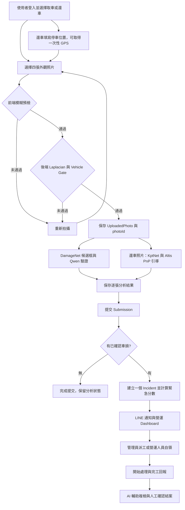

# iRent AI 驗車與營運派工系統

iRent AI 是黑客松展示原型，串接租車人的取車／還車拍照、AI 車損分析與營運派工，讓照片中的異常成為有負責人、處理紀錄與結案狀態的案件。

專案包含 React 介面、Express API 與 Python AI service。公開 repository 提供應用程式與模型介接程式；**KptNetV1／DamageNetV1 模型套件與權重不包含在 repository 中**，需要自行準備。完整車損確認另需啟用 Qwen VLM。

- [AI service 與模型設定](ai_service/README.md)
- [LINE 功能與派工規格](LINE_README.md)
- [API 延遲實測與觀測方式](API_LATENCY.md)
- [比賽實驗附錄 v2](docs/iRent_AI_appendix_v2.pdf)

## 展示功能與目前狀態

| 功能 | 目前實作 |
|---|---|
| 取車／還車驗車 | 四張必填外觀照片：車頭、右側、車尾、左側 |
| 照片品質 | 前端模糊預檢、後端 Laplacian 驗證及車輛偵測 gate |
| 拍攝引導 | KptNetV1 關鍵點、Altis PnP 姿態、Three.js 預覽與八方向 Coverage |
| 車損分析 | DamageNetV1 候選框 → pretrained Qwen VLM 驗證 → 保存車損事件 |
| 髒污偵測 | 清潔案件與派工資料結構已保留；目前模型介接尚無髒污推論 |
| 圖片旋轉分類 | 0°／90°／180°／270° API contract 已保留，模型尚未接入 |
| 還車位置 | 一次性 GPS，以及地址、停車場、樓層、區域、柱號、車格 |
| 營運端 | Dashboard、Submission、地圖、派工、留言、Timeline、完工回報與人工結案 |
| LINE | 非同步通知、簽章驗證、案件連結與急件未接單升級提醒，需設定憑證與目的地 |
| 營運 Agent | Gemini 查詢、SOP／稽核查詢、照片比對與待確認的派工／LINE 草稿，需設定 API Key |

本專案展示 AI 輔助營運流程，尚未完成 production 驗證。AI 結果供人員覆核，求償、停租與最終營運決策需由人工確認。

## 照片與 AI 流程



### 品質檢查與照片數量

前端以輕量模糊預檢減少無效上傳；後端從解碼後圖片重新計算 Laplacian Variance，以 `BLUR_THRESHOLD`（預設 100）判斷清晰度。前端傳入的 `blurPassed` 或分數無法取代後端檢查。

通過清晰度與補充檢查後，後端呼叫 Python `/v1/vehicle-gate` 確認圖片有足夠可信的車輛框，再保存照片。**Python AI service 是照片上傳流程的必要依賴**；服務無法連線時，品質檢查無法完成。

Submission 再次檢查照片擁有者、租約、車牌、流程、角度與保存的品質結果。前端要求四張外觀照；後端另接受 `front_interior`、`backseat_interior` 兩張選填內裝照，目前前端未提供這兩個欄位。

### 拍攝引導與 Coverage

KptNetV1 可靠關鍵點對應 Altis 3D landmarks，再以 PnP 推算相機姿態，提供 `FULL`、`DEGRADED` 或 `UNAVAILABLE` 結果。Three.js 顯示車輛姿態，Coverage 記錄八方向覆蓋率與下一個建議方向。

相機內參採近似值，未經實際相機校正；引導失敗會保留不可用狀態。Coverage 是拍攝輔助資訊，**目前不要求八方向全部覆蓋才可提交**。

還車頁另有相機即時引導介面；目前該預覽請求未附必要的 `photoId`，會被後端拒絕。上傳照片後的引導請求會附 `photoId`，可走既有分析流程。

圖片旋轉分類是另一個尚未接入的功能。`/api/photos/orientation-check` 目前固定回傳 503 `ORIENTATION_MODEL_UNAVAILABLE`，未列入實際品質 gate；圖片解碼時仍會正規化 EXIF orientation。

### 車損確認與不可用結果

1. DamageNetV1 產生 `Scratched`、`Dented`、`Broken` 候選框。
2. 有候選框且 Python 啟用 Qwen 時，以 pretrained Qwen/Qwen2.5-VL-3B-Instruct 驗證候選。此 repository 沒有 Qwen 微調或訓練流程。
3. 只有 Qwen 成功驗證 `is_damage=true` 的候選才成為最終車損事件；可用姿態會提供 3D 定位射線，管理端可保存 mesh raycast 結果。
4. 沒有候選框時跳過 Qwen。有候選但 Qwen 關閉、逾時或失敗時，逐張結果標示 `damage_status=unavailable`／`inference_status=failed`，不以候選框直接建立車損案件。

`QWEN_VLM_ENABLED` 預設 `false`。展示「車損確認 → Incident」時，必須在 **Python process** 設定並成功載入 Qwen；GPU 較適合此流程。設定詳見 [AI service README](ai_service/README.md)。目前 `dirty.detected` 固定 `false`，不能據此宣稱已完成髒污辨識。

照片品質通過後仍需等待每張車損分析結束才可提交；前端停用送出按鈕，後端也會以 `409 ANALYSIS_PENDING` 拒絕未開始或仍在執行中的分析。分析成功且無異常時為 `ok`／無異常，確認異常時為 `warning`／有異常；任何照片分析失敗或不可用時，仍可送出，但整批顯示 `review_required`／待人工確認。部分照片已確認的異常仍會建立 Incident。詳情保存於 `damageSummary` 與逐張 `damage`，提交後不再接受重新分析該照片。

## 案件、派工與 LINE

一次 Submission 最多建立一個 Incident，彙整該次所有照片異常；同台車的下次提交可再開新案。提交支援 idempotency key，避免相同請求重送而重複開案。

```text
pending_assignment → assigned → in_progress → resolved
另支援 false_positive、reopened
```

緊急程度依異常加權：`dirty=1`、`scratch=2`、`dent=3`、`damage/broken=4`，加總上限 10。這是營運規則，並非模型機率；目前新 AI 案件 severity 為 1～3 分 `low`、4～6 分 `medium`、7～10 分 `high`。

管理員可指定人員派工、處理誤報及重新開案；營運人員可自領，並對自己負責的案件留言、開始處理、回報與結案。狀態與版本衝突回傳 409。完工回報保存 AI 複檢結果並標記人工覆核，最終結案由人員操作。

LINE 使用 Messaging API，最多兩個背景工作者發送。NotificationLog 保存 queued／sending／sent／failed／not_configured 等狀態；Webhook 使用 `LINE_CHANNEL_SECRET` 驗證原始內容的 `x-line-signature`。

通知涵蓋開案、派工、留言、開始處理、完工、結案、重開與急件未接單升級。後端每 30 秒掃描一次，升級等待時間預設 `LINE_ESCALATION_MINUTES=10`。LINE 案件連結仍需登入後操作。

- `LINE_CHANNEL_ACCESS_TOKEN`、`LINE_CHANNEL_SECRET`：由伺服器環境提供。
- `LINE_TARGET_ID`：目的地 user／group／room ID；亦可由管理端或 Webhook 保存目的地，環境變數優先。
- `PUBLIC_DASHBOARD_URL`：LINE 案件按鈕使用的公開網址。
- `PUBLIC_BASE_URL`、`LINE_IMAGE_SIGNING_SECRET`：發送車損標註圖時設定；圖片使用短效簽名連結。

完整設定請見 [LINE_README.md](LINE_README.md) 與 [LINEBOT_SETUP.md](LINEBOT_SETUP.md)。

## 登入與權限

| 角色 | 入口與主要權限 |
|---|---|
| user | `/customer`；取車／還車拍照，僅存取自己的照片、Submission 與相關 Incident |
| operator | `/operator/dashboard`；查看營運資料、地圖與通知，自領及處理自己的案件 |
| admin | `/operator/dashboard`；完整營運功能、指派人員、Analytics、Agent 與設定 |

權限以後端和 SQLite User 資料為準，前端選擇角色無法取得額外權限。管理員與營運人員不使用 `/customer` 上傳入口。

密碼採 Argon2id；登入使用 HttpOnly opaque session cookie，資料庫只保存 session token 的 SHA-256 hash。CSRF token 使用另一個可讀 cookie；瀏覽器寫入端點驗證 CSRF，LINE Webhook 使用 LINE 簽章。Production 模式設定 Secure cookies，需搭配 HTTPS。

## 還車位置與地圖

還車至少需要 `address` 與 `parkingSlot`，後端會驗證。另可提供停車場、樓層、區域、柱號與補充說明。Browser Geolocation 只取得一次 GPS，保存緯經度、精度與時間；GPS 失敗仍可使用手動位置完成還車。

admin 與 operator 都可使用 Leaflet／OpenStreetMap 地圖。Marker 按 `urgencyScore` 1～10 由綠色漸變至紅色；無 GPS 的案件保留手動位置，不建立 Marker。地圖頁目前使用 `/api/state` 的案件資料，另提供 `/api/incidents/map` marker API。OSM 用於底圖與案件位置，未整合 OSRM、路徑規劃或 route matching。

## 技術架構

```text
Browser: React / Vite / TypeScript / Tailwind
  ├── Leaflet + OpenStreetMap
  └── Three.js + React Three Fiber / Drei
             │ Session + CSRF / REST API
             ▼
Node.js: Express / TypeScript
  ├── Authentication / RBAC / ownership checks
  ├── Photo quality / Submission / Incident / Dispatch
  ├── SQLite (better-sqlite3) + local uploads
  ├── LINE queue / webhook / notification logs
  ├── Gemini operations agent / drafts / photo review
  └── PerformanceMonitor / StageMetrics
             │ server-to-server HTTP
             ▼
Python: FastAPI
  ├── KptNetV1 → Vehicle Gate / keypoints
  ├── Altis landmarks + OpenCV PnP → capture guidance
  ├── DamageNetV1 → damage candidates
  └── optional pretrained Qwen VLM → candidate verification
```

瀏覽器只呼叫 Express。Python 綁定 localhost 或僅供後端存取的網路；遠端 AI 主機由 `AI_SERVICE_URL` 指定。Render 設定只啟動 Node，需另行部署 Python AI service。

### 專案結構

```text
iRent/
├── frontend/
│   ├── src/components/       # auth、dashboard、analytics、3D vehicle
│   ├── src/pages/            # Login、CustomerFlow、operator pages
│   ├── src/context/          # AuthContext、AppContext
│   ├── src/utils/            # blur、continuous guidance、timeline
│   └── public/models/        # Altis 3D viewer asset
├── backend/
│   ├── src/auth/             # sessions、CSRF、RBAC、login rate limit
│   ├── src/cli/              # create-admin、create-user
│   ├── src/controllers/
│   ├── src/routes/
│   ├── src/services/         # inspection、coverage、lifecycle、urgency、LINE、Agent
│   ├── src/repositories/     # SQLite persistence
│   └── test/                 # unit、integration、latency checks
├── ai_service/
│   ├── app.py                # FastAPI model adapter
│   ├── guidance.py           # Altis PnP
│   ├── vehicle_gate.py
│   ├── qwen_contract.py
│   ├── data/                 # Altis landmarks
│   └── tests/
├── docs/                     # latency report、比賽附錄
├── scripts/docker-smoke.ps1
├── .env.example
├── .env.docker.example
├── docker-compose.yml
├── Dockerfile
├── render.yaml
└── package.json
```

SQLite、uploads、server-side secrets 與模型權重為執行時資料，不隨 repository 發布。以下明確指定根目錄 `outputs/`，讓帳號 CLI 與後端使用同一份資料庫。

## 本機執行

準備 Node.js 22、pnpm、Python 3.11，以及外部 KptNetV1／DamageNetV1 套件。版本基準參考兩個 Dockerfile。沒有模型套件時可啟動 Web UI，但照片流程無法完成。

### 1. 安裝前後端依賴

在專案根目錄執行：

```powershell
pnpm install --frozen-lockfile
pnpm --dir frontend install --frozen-lockfile
pnpm --dir backend install --frozen-lockfile
```

### 2. 啟動 Python AI service

在另一個終端依 [ai_service/README.md](ai_service/README.md) 建立虛擬環境、指定模型路徑並啟動。預設 http://127.0.0.1:8000；`GET /health` 檢查 KptNet／DamageNet readiness，完整車損確認另需確認 `qwen_vlm.loaded=true`。

### 3. 設定 Web process 環境

在專案根目錄的 PowerShell 執行；後續建立帳號與啟動指令使用**同一個終端**：

```powershell
$projectRoot = (Get-Location).Path
$env:DATABASE_PATH = Join-Path $projectRoot 'outputs/irent_ops.db'
$env:UPLOAD_DIR = Join-Path $projectRoot 'outputs/uploads'
$env:NODE_ENV = 'development'
$env:SERVE_FRONTEND = 'false'
$env:AI_SERVICE_URL = 'http://127.0.0.1:8000'
$env:AI_SERVICE_TIMEOUT_MS = '60000'
$env:BLUR_THRESHOLD = '100'
```

`pnpm --dir backend` 的工作目錄是 backend/，`dotenv.config()` 預設讀該目錄的 `.env`；根目錄 `.env` 不會自動載入 Node process。也可將設定存入 Git ignored 的 `backend/.env`，資料庫與 uploads 請使用絕對路徑。

目前未設定 `DATABASE_PATH` 時，Server 預設使用 `backend/outputs/`，帳號 CLI 預設使用根目錄 `outputs/`。請沿用上述明確設定，避免帳號建立於另一份資料庫。既有資料庫不需刪除或覆寫。

### 4. 建立帳號

初次管理員：

```powershell
$env:ADMIN_INITIAL_PASSWORD = 'replace-with-a-strong-password'
pnpm create-admin --username admin01
Remove-Item Env:ADMIN_INITIAL_PASSWORD
```

租車使用者：

```powershell
$env:USER_INITIAL_PASSWORD = 'replace-with-a-different-strong-password'
pnpm create-user --username user01
Remove-Item Env:USER_INITIAL_PASSWORD
```

營運人員：

```powershell
$env:USER_INITIAL_PASSWORD = 'replace-with-another-strong-password'
pnpm create-user --username operator01 --role operator
Remove-Item Env:USER_INITIAL_PASSWORD
```

Username 為 3～32 字元，可用英文字母、數字、`_`、`-`，儲存時統一小寫；密碼需為 12～256 字元。已有管理員時 `create-admin` 會拒絕再次建立；同名 user／operator 也不覆寫既有帳號或密碼。Repository 不提供公開共用帳密。

### 5. 啟動前後端

```powershell
pnpm dev
```

| 服務 | 位址 |
|---|---|
| Frontend | http://localhost:5173 |
| Backend | http://localhost:5188 |
| Backend health | http://localhost:5188/healthz |
| Python AI health | http://127.0.0.1:8000/health |

`pnpm dev` 只啟動 Node 與 Vite，不會啟動 Python。LINE 與 Gemini 為額外整合，未設定時無法展示對應外部服務功能。

### 建置與單一 Web port 展示

沿用第 3 步的環境設定：

```powershell
pnpm build
$env:SERVE_FRONTEND = 'true'
pnpm start
```

Backend 在 http://localhost:5188 提供已建置前端。本機 HTTP 展示沿用 `NODE_ENV=development`；實際部署需設定 `NODE_ENV=production` 並提供 HTTPS，讓 Secure session cookies 正常工作。Production 也應明確設定持久化 `DATABASE_PATH`、`UPLOAD_DIR` 與 `AI_SERVICE_URL`。

## Docker Compose 整合展示

Compose 啟動 web 與 ai 兩個 container；web 提供前端與 API，ai 載入唯讀掛載的外部模型。SQLite、uploads 與本機 secrets 保存在 `irent_outputs` volume。

首次建立 `.env`（若已存在，請編輯既有檔案）：

```powershell
Copy-Item .env.docker.example .env
# 編輯 .env：將 KPTNET_ROOT、DAMAGENET_ROOT 設為實際模型套件的絕對路徑。
docker compose build
docker compose up -d --wait
```

建立 Compose volume 內的管理員與租車使用者：

```powershell
$env:ADMIN_INITIAL_PASSWORD = 'replace-with-a-strong-password'
docker compose run --rm --no-deps -e ADMIN_INITIAL_PASSWORD web pnpm create-admin --username admin01
Remove-Item Env:ADMIN_INITIAL_PASSWORD
$env:USER_INITIAL_PASSWORD = 'replace-with-a-different-strong-password'
docker compose run --rm --no-deps -e USER_INITIAL_PASSWORD web pnpm create-user --username user01
Remove-Item Env:USER_INITIAL_PASSWORD
```

開啟 http://localhost:5188。健康檢查與圖片流程檢查：

```powershell
.\scripts\docker-smoke.ps1 -HealthOnly
.\scripts\docker-smoke.ps1 -Username admin01 -ImagePath C:\path\to\vehicle.jpg
```

圖片流程檢查要求輸入密碼，驗證登入、CSRF、品質、引導與車損推論狀態。**目前 Compose 是 CPU 設定，沒有傳入 QWEN_* 環境變數，也未啟用 Qwen**；若圖片產生候選框，`condition` 結果為 unavailable，完整圖片檢查可能失敗。-HealthOnly 通過只代表服務可用，不能視為 Qwen 或車損開案驗證完成。

完整 Qwen 展示請使用已設定 Qwen 的 Python process／GPU service，或另行調整 Compose 的 AI runtime 與環境設定；只在 `.env` 加入 `QWEN_VLM_ENABLED=true` 不會自動傳入現有 ai container。

停止使用 `docker compose down`。`docker compose down -v` 會刪除 volume 內的資料庫與照片，僅在確定要清空展示資料時使用。

## 環境變數

完整參考值見 [.env.example](.env.example)，Compose 使用 [.env.docker.example](.env.docker.example)。Web 與 Python 是不同 process，設定需提供給對應服務。

| 服務 | 設定 | 用途 |
|---|---|---|
| Web | `DATABASE_PATH`、`UPLOAD_DIR` | 絕對路徑指定 SQLite 與照片儲存位置 |
| Web | `NODE_ENV`、`SERVE_FRONTEND`、`PORT` | Cookie 模式、是否提供前端、API port（預設 5188） |
| Web | `SESSION_TTL_SECONDS`、`COOKIE_SAME_SITE` | Session 有效時間與 cookie policy |
| Web | `CORS_ORIGIN`、`ADDITIONAL_TRUSTED_ORIGINS` | 前端與展示 tunnel 的允許來源 |
| Web | `BLUR_THRESHOLD` | 後端模糊閾值，預設 100 |
| Web | `AI_SERVICE_URL`、`AI_SERVICE_TIMEOUT_MS` | Python 網址與逾時，預設 60 秒 |
| Web | `GEMINI_API_KEY`、`GEMINI_MODEL` | 營運 Agent／照片 review；模型名稱依部署設定 |
| Web | `LINE_*`、`PUBLIC_DASHBOARD_URL`、`PUBLIC_BASE_URL` | 通知、案件按鈕與簽名圖片 |
| Python | `KPTNET_ROOT`、`DAMAGENET_ROOT` | 外部模型套件路徑 |
| Python | `QWEN_VLM_ENABLED`、`QWEN_MODEL_ID`、`QWEN_DEVICE`、`QWEN_QUANTIZATION` | Qwen 開關、模型與裝置 |
| Python | `QWEN_TIMEOUT_SECONDS`、`QWEN_MAX_PIXELS`、`QWEN_BATCH_SIZE` | 驗證時間與記憶體負載 |
| Python | `PNP_NORMALIZED_FOCAL`、`PNP_RANSAC_*` | 內參近似與姿態求解設定 |

`ORIENTATION_CHECK_ENABLED`、`CONDITION_CHECK_ENABLED` 目前只是回報給前端的狀態欄位，**不是端點開關**；false 不會停用 `condition` API，true 也不會使 orientation 模型可用。Qwen 由 Python 的 `QWEN_VLM_ENABLED` 控制。

Gemini Key 可透過管理端「系統設定」存入 Git ignored 的 server-side secret file，不以原值回傳瀏覽器。真實憑證請只放在部署環境或忽略的設定檔中。

## 主要 API

瀏覽器以 Web API 為入口。除 health、登入前 CSRF、LINE webhook 與簽名圖片外，需要登入；瀏覽器 POST 需帶 session cookies 與 `x-csrf-token`。角色與 ownership 由後端檢查。

| Method | Path | 用途／權限 |
|---|---|---|
| GET | `/healthz` | Web process health，不檢查 AI readiness |
| GET | `/api/auth/csrf` | CSRF token |
| POST | `/api/auth/login`、`/api/auth/logout` | 登入／登出 |
| GET | `/api/auth/me` | 目前使用者 |
| GET | `/api/state` | 依角色回傳營運／個人資料 |
| GET | `/api/performance` | admin；API／階段延遲與通知統計 |
| GET | `/api/submissions`、`/api/submissions/:submissionId` | 提交清單與詳細資料；user 限本人 |
| POST | `/api/photos/quality-check` | 品質與 Vehicle Gate，保存照片並回傳 `photoId` |
| POST | `/api/photos/capture-guidance` | 本人 `photoId` + `imageData`；保存 Altis PnP 引導 |
| POST | `/api/photos/condition-check` | 本人 `photoId`；分析保存的圖片 |
| POST | `/api/photos/orientation-check` | 保留 contract，目前固定回傳 503 unavailable |
| POST | `/api/photos/damage-localization` | admin；保存車損 3D raycast 定位 |
| GET | `/api/photos/:photoId/annotated-damage` | admin；車損標註圖 |
| POST | `/api/photo-submissions` | 提交照片與位置；使用已保存的分析 |
| GET | `/api/incidents/map` | admin／operator；有 GPS 的 marker data |
| GET | `/api/operators` | admin；可指派的人員 |
| POST | `/api/incidents` | admin；手動建立案件 |
| POST | `/api/action` | admin／operator；依角色及負責人驗證操作 |
| POST | `/api/settings/line`、`/api/settings/ai` | admin；整合設定 |
| POST | `/api/notifications/line/test` | admin；測試通知 |
| POST | `/api/line/webhook` | LINE 簽章驗證，不使用瀏覽器 CSRF |
| GET | `/api/line-images/:photoId` | LINE 短效圖片，驗證連結簽章 |
| GET | `/uploads/:filename` | 登入及 ownership／角色檢查後取得照片 |

Agent API 皆限 admin：GET `/api/agent/operations`、GET `/api/agent/history`，以及 POST `/api/agent/` 下的 query、sop-query、audit-query、photo-compare、dispatch-drafts、line-drafts、action-drafts/:draftId/confirm。派工／LINE 草稿由管理員確認後才執行。

### 照片 API 順序

先呼叫 `/api/photos/quality-check`，傳入 `imageData`、filename、`rentalId`、`plate`、`phase`、`slot`。通過後，使用回傳的 `photoId`：

```http
POST /api/photos/capture-guidance
Content-Type: application/json
x-csrf-token: <current-token>
```

```json
{
  "photoId": "<quality-check 回傳的 photoId>",
  "imageData": "data:image/jpeg;base64,..."
}
```

`guidance` 是 Altis PnP 結果與 KptNet 摘要，含 `guidance_status`、`solver_used`、`view_sector`、`covered_sectors` 等欄位，不是原始 KptNet 完整輸出。

```http
POST /api/photos/condition-check
Content-Type: application/json
x-csrf-token: <current-token>
```

```json
{ "photoId": "<quality-check 回傳的 photoId>" }
```

`/api/photos/condition-check` 讀取伺服器保存的圖片，回傳 `condition` 與持久化 `damage`，含候選 `detections`、`vlm`、最終 `events`、推論狀態與失敗原因。僅傳 `imageData` 無法使用這兩個已保存照片的端點。

四張完成後，Submission 傳入 `rentalId`、`plate`、`phase` 與 `photos`（每項含 `slot`、`photoId`）；還車需附 `returnLocation.address`、`returnLocation.parkingSlot`。Submission 使用先前保存的 AI 結果，不在提交時重新推論。

## 驗證與測試

在專案根目錄可執行：

```powershell
pnpm build
pnpm --dir backend test:laplacian
pnpm test:security
pnpm --dir backend test:dispatch
pnpm --dir backend test:line-webhook
pnpm --dir backend test:performance
```

另包含車損、Vehicle Gate、Coverage、生命週期、operator RBAC、LINE delivery 與標註圖測試，可依改動範圍選擇 `backend/test/` 檔案。Python 測試在安裝 AI 依賴的環境執行：

```powershell
.\.venv\Scripts\python.exe -m pip install pytest
.\.venv\Scripts\python.exe -m pytest ai_service/tests
```

`pnpm --dir backend benchmark:api` 使用臨時 SQLite fixture，不讀寫本機 runtime DB。管理端僅在可見的 `/operator` 頁面每 15 秒同步 state；使用者頁面不輪詢管理端資料。延遲資料與限制見 [API_LATENCY.md](API_LATENCY.md)。

## 現有限制與後續方向

- 完整圖片流程依賴 repository 外的模型套件；clone 專案不等於已取得模型與可重現推論環境。
- 車損模型介接已實作；Qwen 載入、延遲與資源需求需依實際硬體驗證。預設 CPU Compose 不涵蓋完整 Qwen 確認。
- 引導以 Altis landmarks 與未校正內參為基礎，尚未驗證跨車型準確度；相機即時預覽的 `photoId` 介接仍待修正。
- 髒污推論與旋轉分類尚未接入；分析不可用的提交標記待人工確認，需由營運人員後續覆核。
- 緊急加權、LINE 派工、未接單升級與 Agent SLA 提醒已有實作；完整 SLA 管理、實際預約連動及車輛可租狀態自動化仍待整合。部分營運欄位使用展示規則或預設值。
- 完工 AI 複檢保留人工覆核；未設定 Gemini 或模型不可用時需人工確認。
- SQLite、本機照片儲存與 process 內 login rate limiter 以單一 Backend instance 為前提，正式擴充需另行設計共享儲存與備援。
- 地下停車場 GPS 可能失準，人工位置資料仍是派工依據。

## 其他文件

- [ARCHITECTURE.md](ARCHITECTURE.md)：架構補充
- [WORKFLOW.md](WORKFLOW.md)：業務流程補充
- [SECURITY-REVIEW.md](SECURITY-REVIEW.md)：安全設計與驗證
- [SECURITY-CAVEATS.md](SECURITY-CAVEATS.md)：安全限制
- [CHANGELOG.md](CHANGELOG.md)：歷次更新

本 README 描述目前程式行為；詳細設計文件可能包含尚未完成的規劃，請搭配現有限制與實作閱讀。
