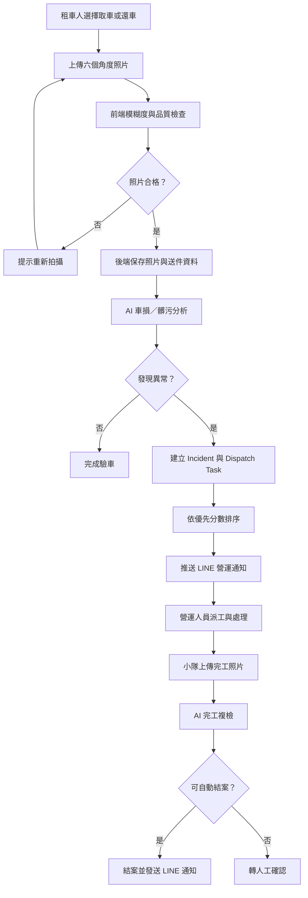

# iRent AI 驗車與營運派工系統

這是一個 Hackathon 展示專案，將租車人的取車／還車照片轉換成可追蹤的營運案件。系統會先檢查照片品質，再以 AI 模擬邏輯判斷車損或髒污，自動建立 Incident、派工並記錄處理歷程。

> LINE 通知目前處於整合規劃階段。現有程式使用 Slack Incoming Webhook；下一階段將改用 LINE Messaging API。LINE Notify 已於 2025-03-31 終止服務，請勿申請或使用 LINE Notify Token。

## 核心功能

### 租車人端

- 選擇取車或還車驗車流程
- 輸入租約編號、車牌與停車位置
- 上傳車頭、車尾、左右車側與內裝照片
- 在瀏覽器執行模糊度檢查，不合格時提示重拍
- 送出照片並取得 AI 檢查摘要

### 營運端

- 查看案件優先順序與營運指標
- 檢視照片送件、案件地圖及派工任務
- 執行派工、留言、開始處理、結案及重新開案
- 上傳維修／清潔完成照片並執行 AI 複檢
- 查閱案件 Timeline 與通知發送紀錄

### 通知整合

- 現況：Slack Incoming Webhook
- 規劃：LINE Official Account + Messaging API Push Message
- 通知事件：AI 建案、派工、客服留言、開始處理、完工回報、結案、重新開案

完整流程與 LINE 串接規格請參考 [WORKFLOW.md](WORKFLOW.md)。

## 系統流程



## 技術架構

```text
React + Vite + TypeScript
           │ REST API
           ▼
Express + TypeScript
       ├── SQLite
       ├── Local Upload Storage
       └── LINE Messaging API（規劃中）
```

| 層級 | 技術 |
|---|---|
| 前端 | React、Vite、TypeScript、Tailwind CSS |
| 後端 | Express、TypeScript |
| 資料庫 | SQLite、better-sqlite3 |
| 通知 | Slack Webhook（現況）、LINE Messaging API（規劃） |
| 部署 | Render |
| 套件管理 | pnpm |

## 專案結構

```text
iRent/
├── frontend/                 React 使用者端與營運後台
├── backend/                  Express API、服務及資料存取
│   └── src/
│       ├── controllers/
│       ├── routes/
│       ├── services/
│       ├── repositories/
│       └── models/
├── outputs/
│   ├── irent_ops.db          SQLite 資料庫
│   └── uploads/              本機上傳照片
├── WORKFLOW.md               業務與 LINE 通知流程
├── render.yaml               Render 部署設定
└── package.json              根目錄指令
```

## LINE 串接前需要準備

請在 LINE Official Account Manager 與 LINE Developers Console 完成以下項目：

1. 一個 LINE Official Account。
2. 啟用該官方帳號的 Messaging API。
3. 正確選擇 Provider；正式專案應使用組織擁有的 Provider。
4. `Channel ID`。
5. `Channel secret`，供未來驗證 LINE Webhook 簽章使用。
6. `Channel access token`，後端呼叫 Push Message API 使用。
7. 通知目的地 ID：個人 `userId`、群組 `groupId` 或聊天室 `roomId`。
8. 若要接收 LINE 事件，準備公開 HTTPS Webhook URL，例如 `https://your-domain.example/api/line/webhook`。

請勿把 Token 或 Secret 提交到 Git。規劃使用以下環境變數：

```env
LINE_CHANNEL_ACCESS_TOKEN=
LINE_CHANNEL_SECRET=
LINE_TARGET_ID=
LINE_WEBHOOK_ENABLED=false
```

`LINE_TARGET_ID` 不是 LINE 顯示名稱或群組名稱，必須是由 LINE webhook event 取得的 `userId`、`groupId` 或 `roomId`。

## 本機開發

安裝依賴：

```bash
pnpm install
pnpm --dir frontend install
pnpm --dir backend install
```

啟動前後端：

```bash
pnpm dev
```

- 前端：`http://localhost:5173`
- 後端健康檢查：`http://localhost:5188/healthz`

建置及正式啟動：

```bash
pnpm build
pnpm start
```

## 主要 API

| Method | Path | 用途 |
|---|---|---|
| GET | `/healthz` | 健康檢查 |
| GET | `/api/state` | 取得儀表板狀態 |
| GET | `/api/submissions` | 取得照片送件清單 |
| GET | `/api/submissions/:submissionId` | 取得送件明細 |
| POST | `/api/photos/quality-check` | 照片品質檢查 |
| POST | `/api/photo-submissions` | 提交整批驗車照片 |
| POST | `/api/incidents` | 建立案件 |
| POST | `/api/action` | 派工、留言、處理及結案 |
| POST | `/api/settings/slack` | 現有 Slack 設定 |
| POST | `/api/line/webhook` | 規劃中的 LINE webhook |

## 部署環境變數

```env
NODE_ENV=production
DATABASE_PATH=/var/data/irent_ops.db
UPLOAD_DIR=/var/data/uploads
LINE_CHANNEL_ACCESS_TOKEN=
LINE_CHANNEL_SECRET=
LINE_TARGET_ID=
```

## 現有限制

- 車損與髒污分析目前是 Hackathon 用的模擬 AI 邏輯。
- LINE Messaging API 已完成整合；Token、Secret 與 Target ID 僅能設定於部署環境。
- 尚未提供登入、角色權限與完整稽核機制。
- SQLite 與本機照片儲存適合展示，不適合多執行個體正式環境。

## LINE 官方文件

- [開始使用 Messaging API](https://developers.line.biz/en/docs/messaging-api/getting-started/)
- [發送 Push Message](https://developers.line.biz/en/docs/messaging-api/sending-messages/)
- [取得 userId、groupId 與 roomId](https://developers.line.biz/en/docs/messaging-api/getting-user-ids/)
- [LINE Notify 終止服務公告](https://developers.line.biz/en/news/2025/04/01/line-notify/)
