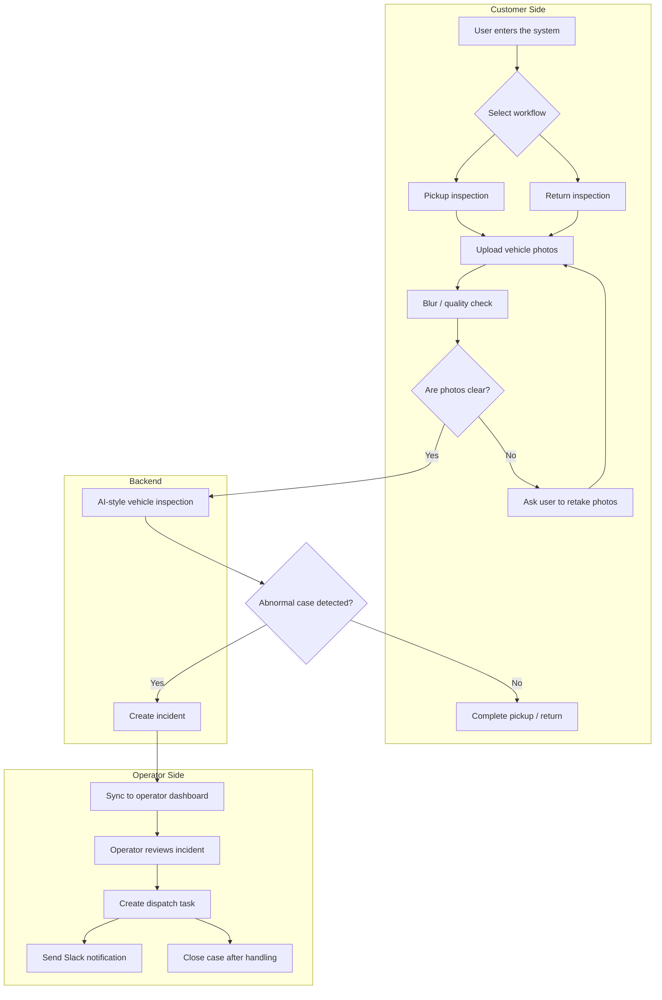

<div align="center">

# 🚗 iRent AI Dashboard

**AI-assisted rental-car inspection and operations dashboard**


</div>

---

## 1. Overview

**iRent AI Dashboard** is a hackathon demo project designed for AI-assisted rental-car pickup, return, and vehicle inspection workflows.

The system combines renter photo submission, blur detection, AI-style vehicle condition analysis, automatic incident creation, operator dashboard management, task dispatching, and Slack notification support.

The goal is to improve the traditional rental-car inspection process from:

```txt
User uploads photos → Operators manually review photos → Issues are handled later
```

to:

```txt
User uploads photos → System checks photo quality → AI assists inspection → Incident is created automatically → Operators handle it in real time
```

---

## 2. Demo

### Live Demo

```txt
https://irent-ai-dashboard.onrender.com
```

### Repository

```txt
https://github.com/yyyunx/iRent-AI-Dashboard
```

### Demo Video

```txt
Coming soon
```

### Screenshots

Screenshots can be added here for the final submission.

```txt
docs/screenshots/customer-flow.png
docs/screenshots/operator-dashboard.png
docs/screenshots/submissions.png
```

---

## 3. Problem

Rental-car services rely heavily on pickup and return photos to verify vehicle condition. However, this process often creates several operational problems.

### Customer-side Problems

- Uploaded photos may be blurry, incomplete, or taken from the wrong angle.
- Users may receive vehicles with existing damage or interior mess left by previous renters.
- Without instant checking, responsibility for vehicle damage can become unclear.

### Operator-side Problems

- Operators need to manually review a large number of photos.
- New damage, dirty interiors, and abnormal cases are difficult to detect quickly.
- Customer service, operations, cleaning, and repair workflows may become disconnected.
- Abnormal cases are not always converted into trackable tasks immediately.

---

## 4. Solution

This project provides an AI-assisted inspection workflow:

```txt
User uploads vehicle photos
→ System performs blur / quality check
→ Passed photos are analyzed by AI-style inspection logic
→ Abnormal cases automatically create incidents
→ Operators review incidents on the dashboard
→ Tasks and notifications are created for follow-up
```

### The system provides:

- Customer pickup and return photo flows
- Photo blur and quality validation
- AI-style vehicle condition analysis
- Automatic incident creation
- Operator dashboard
- Photo submission records
- Task dispatch and status tracking
- Slack webhook notification support
- Responsive web design for desktop, tablet, and mobile devices

---

## 5. User Flow

### Pickup Flow

1. The user enters the pickup inspection page.
2. The user confirms vehicle and rental information.
3. The user uploads exterior and interior vehicle photos.
4. The system performs blur detection.
5. If a photo is unclear, the user is asked to retake it.
6. If photos pass the quality check, the inspection result is submitted.
7. If an abnormal condition is detected, a report is created and sent to the operator dashboard.
8. The user completes the pickup process.

### Return Flow

1. The user enters the return inspection page.
2. The user uploads vehicle exterior and interior photos.
3. The system checks photo quality.
4. Passed photos are analyzed by the AI-style inspection workflow.
5. If no abnormal condition is found, the return process is completed.
6. If suspected damage or interior mess is detected, an incident is created.
7. Operators review the incident and handle follow-up tasks.

---

## 6. Features

### Customer Side

- Pickup / return workflow selection
- Vehicle photo upload
- Blur detection
- Real-time retake reminder
- Submission result summary
- Responsive layout for mobile, tablet, and desktop

### Operator Side

- Operations dashboard
- Incident list
- Photo submission review
- Task dispatch management
- Analytics page
- Settings page
- Slack webhook configuration

### AI / Automation

- Blur detection for photo quality checking
- AI-style vehicle condition analysis
- Automatic incident creation
- Task status tracking
- Slack notification workflow

---

## 7. Workflow



---

## 8. Architecture

This project was rebuilt from an earlier single-page HTML and Python prototype into a React + Express full-stack architecture.

### Current Architecture

```txt
React Frontend
    ↓
Express API Server
    ↓
SQLite Demo Database
```

### Development Mode

```txt
Frontend: React + Vite
URL: http://localhost:5173

Backend: Express + TypeScript
URL: http://localhost:5188

Database:
outputs/irent_ops.db
```

### Production Mode

```txt
Render Node.js Web Service
    ↓
Express serves frontend/dist
    ↓
Express handles /api routes
    ↓
SQLite demo database
```

### Project Structure

```txt
iRent-AI-Dashboard/
├─ frontend/              # React + Vite frontend
│  └─ src/
│     ├─ pages/
│     ├─ context/
│     ├─ components/
│     └─ utils/
├─ backend/               # Express + TypeScript backend
│  └─ src/
│     ├─ controllers/
│     ├─ routes/
│     ├─ services/
│     ├─ repositories/
│     └─ models/
├─ outputs/
│  ├─ irent_ops.db        # Demo SQLite database
│  └─ uploads/            # Local uploaded images
├─ package.json           # Root scripts
├─ render.yaml            # Render deployment reference
└─ README.md
```

---

## 9. Technical Highlights

- Rebuilt the original prototype into a modular React + Express full-stack application.
- Separated customer workflows and operator dashboard into different frontend routes.
- Implemented blur / quality check before photo submission.
- Designed an incident-driven workflow connecting customer reports with operator actions.
- Added a Settings page for configurable parameters.
- Added Slack webhook support for operational notifications.
- Built responsive layouts for desktop, tablet, and mobile screens.
- Deployed the full-stack demo as a Node.js web service on Render.
- Used SQLite as a lightweight demo database for hackathon demonstration.

---

## 10. Tech Stack

| Layer | Technology |
|---|---|
| Frontend | React, Vite, TypeScript |
| Styling | Tailwind CSS |
| Backend | Express, TypeScript |
| Database | SQLite |
| SQLite Driver | better-sqlite3 |
| Deployment | Render |
| Notification | Slack Webhook |
| Package Manager | pnpm |

---

## 11. Local Development

### Install Dependencies

```bash
pnpm install
pnpm --dir frontend install
pnpm --dir backend install
```

### Run Development Server

```bash
pnpm dev
```

Open the frontend:

```txt
http://localhost:5173
```

Backend health check:

```txt
http://localhost:5188/healthz
```

### Build

```bash
pnpm build
```

### Start Production Server Locally

```bash
pnpm start
```

---

## 12. Deployment

This project is deployed as a Node.js web service on Render.

### Render Build Command

```bash
pnpm install --frozen-lockfile && pnpm --dir frontend install --frozen-lockfile && pnpm --dir backend install --frozen-lockfile && pnpm build
```

### Render Start Command

```bash
pnpm start
```

### Render Environment Variables

For short-term demo deployment on Render Free:

```txt
NODE_ENV=production
DATABASE_PATH=outputs/irent_ops.db
UPLOAD_DIR=outputs/uploads
SLACK_WEBHOOK_URL=optional
```

### Health Check Path

```txt
/healthz
```

---

## API Surface

### Health

```txt
GET /healthz
```

### Dashboard / State

```txt
GET /api/state
```

### Photo Submissions

```txt
GET /api/submissions
GET /api/submissions/:submissionId
POST /api/photos/quality-check
POST /api/photo-submissions
```

### Incidents / Actions

```txt
POST /api/incidents
POST /api/action
```

### Settings

```txt
POST /api/settings/slack
```

---

## 13. Limitations and Future Work

### Current Limitations

This project currently uses local SQLite and local upload storage for demo purposes.

On Render Free, the filesystem is not persistent. Runtime data may be lost after:

- Redeploy
- Restart
- Service spin down
- Free instance wake-up

This is acceptable for a short-term hackathon demo, but not suitable for production data persistence.

### Future Work

- Replace local SQLite with Supabase Postgres or Neon Postgres.
- Replace local upload storage with Supabase Storage or Cloudinary.
- Connect real vehicle damage detection models.
- Add car-part localization for front / rear / left / right inspection.
- Add user authentication and role-based access control.
- Add detailed audit logs for incident handling.
- Add real-time notification and task assignment workflow.

---

## Demo Database

`outputs/irent_ops.db` is kept as a demo SQLite database for local review and demo usage.

It is not intended to be used as a production database.

---

## Repository Hygiene

The repository should not commit:

- `node_modules/`
- `dist/`
- `.env*`
- logs
- runtime uploads
- SQLite journal / WAL files
- Python cache files

Ignored examples:

```txt
node_modules/
dist/
.env*
*.log
outputs/uploads/
outputs/__pycache__/
*.db-journal
*.db-wal
*.db-shm
```

---

## Legacy Python Server

The old Python server:

```txt
outputs/shared_ops_server.py
```

is legacy and is no longer used for Render deployment.

The current deployment target is:

```txt
React frontend + Express backend + SQLite demo database
```

---

<div align="center">

**Built for iRent AI-assisted vehicle inspection and operations workflow demo.**

</div>
