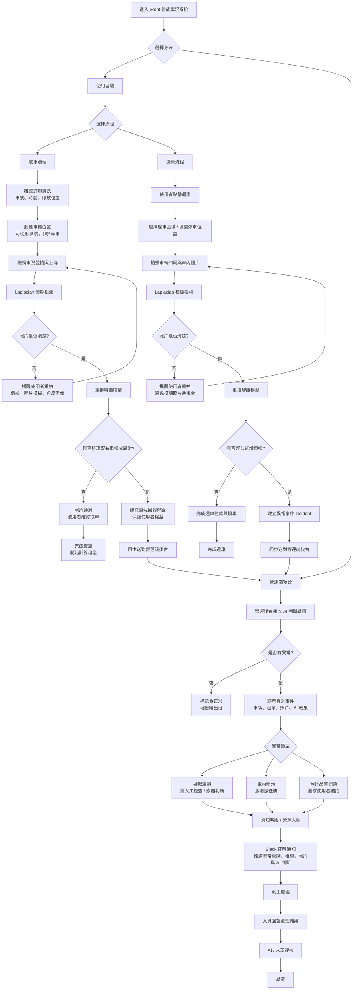

# iRent AI Dashboard

本專案是一套針對 iRent 取車、還車流程設計的 AI 智能車況管理系統。  
系統會在使用者上傳車輛照片時，先進行照片品質檢查，例如模糊檢測，再透過車損辨識模型判斷是否有疑似異常。  
若系統偵測到車損、髒污或照片品質問題，會自動建立 Incident，並同步到營運後台，讓客服與營運人員可以即時追蹤、通知與派工處理。

---

## 系統流程圖



---

## 核心功能

### 使用者端：取車流程

使用者在取車前可以確認訂單資訊、承租車號、租車時間與車輛停放位置。  
到達車輛附近後，可透過導航或叭叭尋車功能找到車輛。

取車時，使用者上傳車輛外觀照片，系統會先進行 Laplacian 模糊檢測。  
若照片模糊或角度不佳，系統會即時提醒使用者重新拍攝，避免低品質照片進入後台。

照片通過檢查後，系統會進一步使用車損辨識模型判斷是否有既有車損或異常。  
若取車時已發現異常，系統會建立車況回報紀錄，保護使用者權益，避免還車時責任歸屬不清。

---

### 使用者端：還車流程

使用者還車時，需要選擇還車區域、填寫停車位置，並拍攝車輛四周與車內照片。

照片上傳後，系統同樣會先進行 Laplacian 模糊檢測。  
若照片不清楚，會要求使用者重新拍攝。

若照片通過檢查，系統會透過車損辨識模型判斷是否有疑似新增車損。  
若偵測到異常，系統會自動建立 Incident，並同步到營運端後台，方便客服與營運人員即時處理。

---

### 營運端：後台 Dashboard

營運人員可以在後台查看 AI 判斷結果與異常事件，包括：

- 車牌
- 租借單號
- 取車 / 還車階段
- 上傳照片
- AI 判斷結果
- 異常類型
- 處理狀態

當系統偵測到異常時，會透過 Slack 即時通知客服或營運人員。  
營運端可根據異常類型進行人工複查、清潔派工、索賠判斷與結案處理。

---

## AI 模型

本專案目前預計整合兩種 AI / CV 模型：

### 1. Laplacian 模糊檢測

用於判斷使用者上傳的照片是否清楚。  
若照片過於模糊，系統會即時提醒使用者重新拍攝。

### 2. 車損辨識模型

用於辨識車輛外觀照片中是否有疑似刮痕、凹痕或其他異常。  
若模型判斷有疑似車損，系統會建立 Incident 並同步到營運後台。

---

## 系統特色

- 使用者端即時照片防呆
- Laplacian 模糊檢測
- 車損辨識模型串接
- 取車既有異常紀錄，保護使用者權益
- 還車疑似新增車損自動預警
- 營運端 Incident Dashboard
- Slack 即時通知
- 派工、回報、複核與結案流程

---

## 專案結構

```txt
iRent-AI-Dashboard/
├── outputs/
│   ├── irent-ops-dashboard.html
│   └── shared_ops_server.py
├── work/
├── README.md
├── render.yaml
└── requirements.txt
```

---

## 執行方式

安裝套件：

```bash
pip install -r requirements.txt
```

啟動後端服務：

```bash
python outputs/shared_ops_server.py
```

開啟前端頁面：

```txt
outputs/irent-ops-dashboard.html
```

---

## 專案目標

本專案希望透過 AI 協助 iRent 優化取車與還車流程。  
系統不只是在使用者端檢查照片品質，也會將 AI 車況判斷結果同步到營運端，讓客服與營運人員可以更快掌握車損、髒污與照片品質問題，進一步提升租還車體驗與營運效率。
---

## Photo Submission APIs

The dashboard keeps the original operations workflow and adds a mock renter photo flow for pickup and return inspections.

### POST `/api/photos/quality-check`

Runs a mock Laplacian-style quality check and stores uploaded photo metadata.

Request example:

```json
{
  "rentalId": "R-20260704-001",
  "plate": "ABC-1234",
  "phase": "pickup",
  "slot": "front",
  "filename": "front.jpg",
  "imageData": "base64..."
}
```

Response includes `photoId` and a `quality` object with `passed`, `blurScore`, `isBlur`, `plateVisible`, `angleValid`, `distanceValid`, and `message`.

### POST `/api/photo-submissions`

Submits a pickup or return photo set, runs mock vehicle AI analysis, stores the submission, and creates incidents when new damage or dirty interior is detected.

Response includes `submissionId`, `overallStatus`, `results`, and `createdIncidents`.

### GET `/api/submissions`

Returns recent photo submissions for the dashboard.

### GET `/api/submissions/{submissionId}`

Returns one submission with uploaded photos and AI result metadata.

### GET `/api/state`

Now also includes `photoSubmissions` and `uploadedPhotos`.

These additions are stored in SQLite tables `PhotoSubmission` and `UploadedPhoto`. Existing Incident, Slack log, AI Review, Render, and operations dashboard behavior remain in place.
