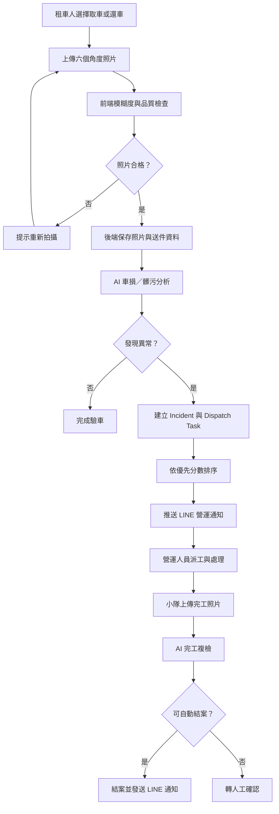

# iRent AI 驗車與營運派工系統

這是一個 Hackathon 展示專案，將租車人的取車／還車照片轉換成可追蹤的營運案件。系統會先檢查照片品質，再以 AI 模擬邏輯判斷車損或髒污，自動建立 Incident、派工並記錄處理歷程。

## 核心功能

### Authentication 與權限

- 單一登入入口，角色由 SQLite `User` 資料決定。
- 密碼使用 Argon2id；瀏覽器只保存 HttpOnly opaque session cookie，資料庫只保存 session token 的 SHA-256 hash。
- 所有寫入 API 使用 CSRF token；admin API 由後端 RBAC 強制檢查。
- 一般使用者只能查看自己的送件、照片與相關 Incident；管理員可操作完整營運流程。

### 租車人端

- 選擇取車或還車驗車流程
- 輸入租約編號、車牌與停車位置
- 上傳車頭、車尾、左右車側與內裝照片
- 在瀏覽器執行模糊度檢查，不合格時提示重拍
- 送出照片並取得 AI 檢查摘要

### 營運端

- 查看案件優先順序與營運指標
- 檢視照片送件、案件地圖及派工任務
- 執行派工、留言、開始處理、結案及重新開案
- 上傳維修／清潔完成照片並執行 AI 複檢
- 查閱案件 Timeline 與通知發送紀錄

### 通知整合

- 現況：LINE Official Account + Messaging API Push Message
- 發送機制：通知先寫入 `NotificationLog`，再由最多兩個背景工作者非同步發送
- Webhook：以 `LINE_CHANNEL_SECRET` 驗證 `x-line-signature`，並擷取 `userId`、`groupId` 或 `roomId`
- 通知管道：只使用 LINE Bot，不提供 Slack 設定或發送端點
- 通知事件：AI 建案、派工、客服留言、開始處理、完工回報、結案、重新開案

完整流程與 LINE 串接規格請參考 [WORKFLOW.md](WORKFLOW.md)。

## 系統流程



## 技術架構

```text
React + Vite + TypeScript
           │ REST API／每 3 秒同步狀態
           ▼
Express + TypeScript
       ├── DashboardController：HTTP 輸入與回應
       ├── DashboardService：驗車、AI 模擬、案件與派工流程
       ├── DatabaseRepository：SQLite schema 與資料存取
       ├── PerformanceMonitor：API 平均值、P50、P95 與錯誤率
       ├── Local Upload Storage：驗車及完工照片
       └── NotificationService
             ├── LINE 非同步發送佇列
             ├── LINE Webhook HMAC-SHA256 驗證
             └── LINE 發送紀錄與錯誤追蹤
```

| 層級 | 技術 |
|---|---|
| 前端 | React、Vite、TypeScript、Tailwind CSS |
| 後端 | Express、TypeScript |
| 資料庫 | SQLite、better-sqlite3 |
| 通知 | LINE Messaging API、簽章驗證與非同步佇列 |
| 部署 | Render |
| 套件管理 | pnpm |

## 專案結構

```text
iRent/
├── frontend/                         React 使用者端與營運後台
│   ├── src/
│   │   ├── components/
│   │   │   └── ToastContainer.tsx    全域操作提示
│   │   ├── context/
│   │   │   └── AppContext.tsx        共用狀態、API 呼叫與三秒輪詢
│   │   ├── pages/
│   │   │   ├── RoleSelection.tsx     租車人／營運人員角色入口
│   │   │   ├── CustomerFlow.tsx      取還車驗車與照片上傳流程
│   │   │   └── operator/
│   │   │       ├── Dashboard.tsx     營運總覽
│   │   │       ├── Submissions.tsx   照片送件
│   │   │       ├── MapView.tsx       案件地圖
│   │   │       ├── Tasks.tsx         派工任務
│   │   │       ├── Notifications.tsx 通知紀錄
│   │   │       ├── Analytics.tsx     分析指標
│   │   │       └── Settings.tsx      LINE Bot／OpenAI Agent 設定
│   │   ├── utils/
│   │   │   └── blurDetection.ts      瀏覽器端照片模糊度檢查
│   │   ├── App.tsx                   路由與頁面 lazy loading
│   │   └── main.tsx                  前端進入點
│   ├── vite.config.ts
│   └── package.json
├── backend/                          Express API 與領域邏輯
│   ├── src/
│   │   ├── controllers/
│   │   │   └── DashboardController.ts HTTP 輸入驗證與回應
│   │   ├── routes/
│   │   │   └── apiRoutes.ts          REST API 路由
│   │   ├── services/
│   │   │   ├── DashboardService.ts   驗車、案件、派工與 AI 複檢
│   │   │   ├── AiAgentService.ts     OpenAI Responses API 營運分析
│   │   │   ├── NotificationService.ts LINE 佇列與 Webhook 驗證
│   │   │   └── PerformanceMonitor.ts API 效能量測
│   │   ├── repositories/
│   │   │   └── DatabaseRepository.ts SQLite schema 與資料存取
│   │   ├── models/
│   │   │   └── types.ts              資料模型與 API 映射
│   │   ├── app.ts                    Middleware、路由與前端靜態檔
│   │   └── server.ts                 後端啟動點與環境設定
│   └── package.json
├── outputs/                          執行期資料，不屬於程式碼
│   ├── irent_ops.db                  SQLite 資料庫
│   ├── uploads/                      驗車與完工照片
│   └── secrets/                      本機 API Key（Git 忽略）
├── ARCHITECTURE.md                   詳細技術架構
├── WORKFLOW.md                       業務與 LINE 通知流程
├── LINEBOT_SETUP.md                  LINE Bot 設定說明
├── render.yaml                       Render 服務與持久磁碟設定
├── Dockerfile                        容器建置設定
└── package.json                      根目錄建置與啟動指令
```

## LINE 串接前需要準備

請在 LINE Official Account Manager 與 LINE Developers Console 完成以下項目：

1. 一個 LINE Official Account。
2. 啟用該官方帳號的 Messaging API。
3. 正確選擇 Provider；正式專案應使用組織擁有的 Provider。
4. `Channel ID`。
5. `Channel secret`，供未來驗證 LINE Webhook 簽章使用。
6. `Channel access token`，後端呼叫 Push Message API 使用。
7. 通知目的地 ID：個人 `userId`、群組 `groupId` 或聊天室 `roomId`。
8. 若要接收 LINE 事件，準備公開 HTTPS Webhook URL，例如 `https://your-domain.example/api/line/webhook`。

請勿把 Token 或 Secret 提交到 Git。規劃使用以下環境變數：

```env
LINE_CHANNEL_ACCESS_TOKEN=
LINE_CHANNEL_SECRET=
LINE_TARGET_ID=
OPENAI_API_KEY=
OPENAI_MODEL=gpt-5-mini
LINE_WEBHOOK_ENABLED=false
OPENAI_API_KEY=
OPENAI_MODEL=gpt-5-mini
```

`LINE_TARGET_ID` 不是 LINE 顯示名稱或群組名稱，必須是由 LINE webhook event 取得的 `userId`、`groupId` 或 `roomId`。

## 本機開發

安裝依賴：

```bash
pnpm install
pnpm --dir frontend install
pnpm --dir backend install
```

啟動前後端：

```bash
pnpm dev
```

- 前端：`http://localhost:5173`
- 後端健康檢查：`http://localhost:5188/healthz`

建置及正式啟動：

```bash
pnpm build
pnpm start
```

## API

| Method | Path | 用途 |
|---|---|---|
| GET | `/healthz` | 健康檢查 |
| GET | `/api/state` | 取得案件、Timeline、留言、通知、送件、照片及營運指標等完整儀表板狀態 |
| GET | `/api/performance` | 取得最近 200 次 API 請求的平均延遲、P50、P95、錯誤率及通知統計 |
| GET | `/api/submissions` | 取得照片送件清單 |
| GET | `/api/submissions/:submissionId` | 依 `submissionId` 取得送件資料與照片明細 |
| POST | `/api/photos/quality-check` | 儲存單張照片並執行模糊、車牌、角度與距離品質檢查 |
| POST | `/api/photo-submissions` | 提交整批驗車照片、執行 AI 模擬分析，必要時自動建立案件 |
| POST | `/api/incidents` | 手動建立案件並回傳最新儀表板狀態 |
| POST | `/api/action` | 執行案件操作；支援 `dispatch`、`comment`、`in_progress`、`resolve`、`reopen`、`maintenance_report` |
| POST | `/api/settings/line` | 更新 LINE 目標 ID、顯示名稱及通知啟用狀態；Access Token 不寫入資料庫 |
| POST | `/api/settings/ai` | 更新 OpenAI 模型與伺服器端 API Key；Key 不會在 state 回傳 |
| POST | `/api/agent/query` | 以目前 Incident、熱點及營運指標呼叫 OpenAI Responses API |
| POST | `/api/notifications/line/test` | 將 LINE 測試訊息加入非同步發送佇列 |
| POST | `/api/line/webhook` | 驗證 LINE Webhook 簽章並擷取通知目標 ID |
| GET | `/uploads/:filename` | 讀取已上傳的驗車或完工照片 |
| GET | `/api/auth/csrf` | 取得 CSRF token 並設定 CSRF cookie |
| POST | `/api/auth/login` | 建立並 rotate server-side session |
| POST | `/api/auth/logout` | 撤銷 server-side session 並清除 cookie |
| GET | `/api/auth/me` | 取得目前登入者的安全欄位 |

`POST /api/action` 的共用請求欄位為 `incidentId` 與 `action`。`comment` 另接受 `author`、`body`；`maintenance_report` 另接受 `note` 與 Base64 編碼的 `photo`。所有 JSON／Base64 請求的大小上限為 50 MB。

## 部署環境變數

```env
NODE_ENV=production
DATABASE_PATH=/var/data/irent_ops.db
UPLOAD_DIR=/var/data/uploads
SESSION_TTL_SECONDS=28800
COOKIE_SAME_SITE=Lax
CORS_ORIGIN=https://your-frontend.example
LINE_CHANNEL_ACCESS_TOKEN=
LINE_CHANNEL_SECRET=
LINE_TARGET_ID=
```

正式環境的 session cookie 會自動加上 `HttpOnly` 與 `Secure`。同網域部署維持 `SameSite=Lax`；只有確實跨站且全程 HTTPS 時才設定 `COOKIE_SAME_SITE=None`，並將允許的前端 origin 寫入 `CORS_ORIGIN`。

首次建立管理員時，以一次性環境變數執行：

```powershell
$env:ADMIN_INITIAL_PASSWORD='use-a-strong-one-time-value'
pnpm create-admin --username admin01
Remove-Item Env:ADMIN_INITIAL_PASSWORD
```

CLI 只允許在尚無 admin 時建立第一個管理員；若 admin 已存在，命令會拒絕執行且不會重設密碼。不要把上述值寫入 `.env` 或提交到 Git。

一般使用者以相同的一次性方式建立：

```powershell
$env:USER_INITIAL_PASSWORD='use-a-strong-one-time-value'
pnpm create-user --username user01
Remove-Item Env:USER_INITIAL_PASSWORD
```

使用者名稱會正規化為小寫，須為 3～32 個英文字母、數字、底線或減號；同 username 已存在時不會覆寫密碼。舊版 email schema 會以 additive migration 增加 username，登入不再使用 email。

## 現有限制

- 照片車損與髒污辨識目前仍是 Hackathon 用的模擬邏輯；營運分析 Agent 已使用 OpenAI Responses API。
- Analytics 另提供不依賴模型猜測的交班摘要、SLA 逾時／近期預約預警、Incident 群聚證據與智慧派工草稿。這些端點僅限 admin，派工草稿目前不會直接寫入資料庫。
- Agent 查詢歷史會保存使用者、模型、狀態與截斷去敏後的問題／結果摘要，不保存 API key、session/CSRF token 或完整敏感 prompt。
- 智慧派工與 LINE 通知採兩段式流程：先產生 10 分鐘有效的後端草稿，管理員預覽後再次確認；確認時後端重新驗證 RBAC、CSRF、草稿狀態與 Incident 最新狀態，且不採信前端提交的小隊或訊息內容。
- LINE Messaging API 已完成整合；Token、Secret 與 Target ID 僅能設定於部署環境。
- 登入限流目前位於單一 backend process；水平擴充前需移至 shared store。
- SQLite 與本機照片儲存以 Render persistent disk、單一 backend instance 為前提；備份與監控限制請見 `SECURITY-CAVEATS.md`。

## LINE 官方文件

- [開始使用 Messaging API](https://developers.line.biz/en/docs/messaging-api/getting-started/)
- [發送 Push Message](https://developers.line.biz/en/docs/messaging-api/sending-messages/)
- [取得 userId、groupId 與 roomId](https://developers.line.biz/en/docs/messaging-api/getting-user-ids/)
- [LINE Notify 終止服務公告](https://developers.line.biz/en/news/2025/04/01/line-notify/)
