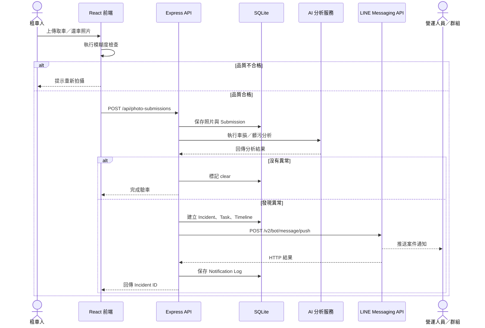

# iRent 業務與 LINE 通知 Workflow

## 1. 目標

當驗車流程產生異常案件或案件狀態改變時，由 Express 後端透過 LINE Messaging API 主動推送訊息給指定營運人員或營運群組，同時將成功或失敗結果寫入 SQLite，避免只在前端顯示而沒有稽核紀錄。

## 2. 端到端流程



## 3. 通知事件

| 事件 | eventType | 觸發時機 | 建議訊息內容 |
|---|---|---|---|
| AI 發現異常 | `ai_detected` | 建立 Incident 後 | 車牌、事件、站點、信心度、優先分數 |
| 派工 | `dispatch` | 指派維修／清潔團隊後 | 案件編號、團隊、區域、期限 |
| 客服留言 | `comment` | 新增重要留言後 | 案件編號、作者、留言摘要 |
| 開始處理 | `in_progress` | 小隊開始執行任務 | 案件、處理人、開始時間 |
| 完工回報 | `maintenance_report` | 上傳完工照後 | AI 複檢結果、信心度 |
| 結案 | `resolved` | 人工或 AI 結案後 | 結案方式與處理摘要 |
| 重新開案 | `reopen` | 複檢未通過或人工重開 | 原因及新負責團隊 |

## 4. LINE Push Message 規格

後端呼叫：

```http
POST https://api.line.me/v2/bot/message/push
Authorization: Bearer {LINE_CHANNEL_ACCESS_TOKEN}
Content-Type: application/json
```

Body：

```json
{
  "to": "{LINE_TARGET_ID}",
  "messages": [
    {
      "type": "text",
      "text": "【iRent AI 異常通知】\n案件：INC-AI-001\n車牌：ABC-1234\n事件：左側刮傷\n站點：台北車站\n優先分數：100"
    }
  ]
}
```

`to` 可使用 LINE webhook event 提供的 `userId`、`groupId` 或 `roomId`。

## 5. 需要準備的資料

| 資料 | 必要 | 取得位置／方式 | 用途 |
|---|---:|---|---|
| LINE Official Account | 是 | LINE Official Account Manager | 通知發送者 |
| Provider | 是 | LINE Developers Console | 管理 Channel 所屬組織 |
| Messaging API Channel | 是 | 對官方帳號啟用 Messaging API | 呼叫 Messaging API |
| Channel ID | 是 | Basic settings | Channel 識別 |
| Channel secret | Webhook 時必要 | Basic settings | 驗證 `x-line-signature` |
| Channel access token | 是 | Messaging API settings | API Bearer Token |
| `userId`／`groupId`／`roomId` | 是 | LINE webhook event | Push Message 收件人 |
| 公開 HTTPS Webhook URL | 取得群組 ID或雙向互動時必要 | Render 網址 | 接收 follow、message、join 等事件 |

Token、Secret 和 Target ID 都視為敏感資料，不應放在 README、前端程式或 Git。

## 6. Target ID 取得流程

### 個人通知

1. 使用者加入 LINE Official Account 好友。
2. 使用者傳一則訊息給官方帳號。
3. LINE 將 message event POST 到 `/api/line/webhook`。
4. 後端從 `events[].source.userId` 取得 Target ID。

### 群組通知

1. 在 Messaging API 設定允許 Bot 加入群組。
2. 將 LINE Official Account 邀請進營運群組。
3. 群組內傳送訊息或觸發 join event。
4. 後端從 `events[].source.groupId` 取得 Target ID。

不應要求使用者手動猜測 ID；LINE 群組名稱不能替代 `groupId`。

## 7. 安全要求

- 驗證 webhook request 的 `x-line-signature`，使用原始 request body 和 Channel Secret 計算 HMAC-SHA256。
- Access Token 只存在後端環境變數或 Secrets Manager。
- API 回傳給前端時不得包含 Token、Secret 或完整 Target ID。
- 通知保存事件、目標類型、狀態、嘗試次數與錯誤訊息，但不保存 Access Token。
- 對暫時性錯誤進行有限重試，並使用唯一 retry key 避免重複推送。
- 正式環境應將不同站點／區域對應到不同 LINE Target ID。

## 8. 建議後端模組

```text
backend/src/
├── services/LineMessagingService.ts
├── controllers/LineWebhookController.ts
├── routes/lineRoutes.ts
└── models/notificationTypes.ts
```

建議將目前 `sendSlack()` 抽象成共同的 `NotificationService`，保留 Slack 或切換 LINE，而不是在各個案件 action 中重複呼叫不同平台。

```text
Incident event
      ↓
NotificationService
      ├── LineMessagingProvider
      └── SlackProvider（可選）
      ↓
Notification Log
```

## 9. 實作順序

1. 建立 LINE Official Account 並啟用 Messaging API。
2. 取得 Channel access token 與 Channel secret。
3. 新增 `/api/line/webhook` 並驗證簽章。
4. 取得測試用 `userId` 或營運群組 `groupId`。
5. 實作 `LineMessagingService.sendPush()`。
6. 將既有 Incident 事件接到 `NotificationService`。
7. 新增 LINE 設定頁及測試通知按鈕。
8. 記錄發送結果並測試失敗重試。
9. 在 Render 設定 Secret 環境變數。
10. 完成個人、群組、Token 錯誤及 LINE API 暫時失敗測試。

## 10. 驗收條件

- AI 建立案件後，指定 LINE 使用者或群組能收到一則通知。
- 派工、完工及結案事件能收到對應通知。
- LINE 未設定時，案件本身仍可正常建立及更新。
- Token 無效或 API 失敗時，系統保存錯誤但不洩漏 Token。
- webhook 簽章錯誤時回傳 `401`。
- 同一事件重試不會造成重複通知。

